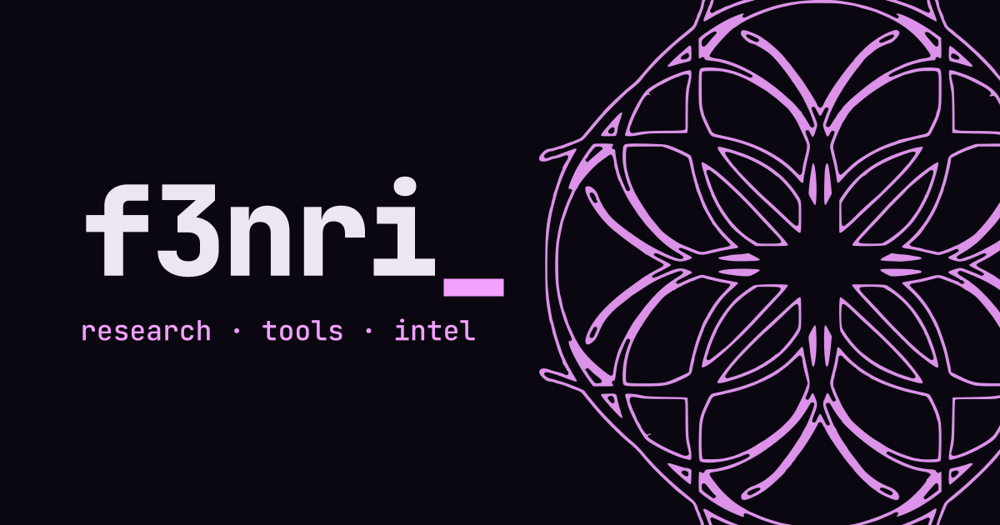

<p align="center"></p>

# f3nri.com

Source of [f3nri.com](https://f3nri.com), the website of f3nri, an independent security research team.

Built with [Astro](https://astro.build) as a static site. Merging to `main` deploys to production.

## Quick start

```bash
nvm use        # Node 22
npm ci
npm run dev    # http://localhost:4321
npm run ci     # format check + type check + build; must pass before pushing
```

## Working on this repo

Read [`AGENTS.md`](AGENTS.md) first. It applies to humans and AI agents alike: roles, the task workflow, hard rules and the definition of done. The current task board is [`.agents/STATE.md`](.agents/STATE.md).

| Doc                                            | About                              |
| ---------------------------------------------- | ---------------------------------- |
| [`docs/PRODUCT.md`](docs/PRODUCT.md)           | What the site is and what is on it |
| [`docs/DESIGN.md`](docs/DESIGN.md)             | Brand, tokens and visual rules     |
| [`docs/ARCHITECTURE.md`](docs/ARCHITECTURE.md) | Stack, folders, CI and deploy      |
| [`docs/decisions/`](docs/decisions)            | Architecture decision records      |

Brand assets come from [f3nrilabs/brand](https://github.com/f3nrilabs/brand).

## Reporting a security issue

See [`/.well-known/security.txt`](public/.well-known/security.txt) or email hello@f3nri.com.
